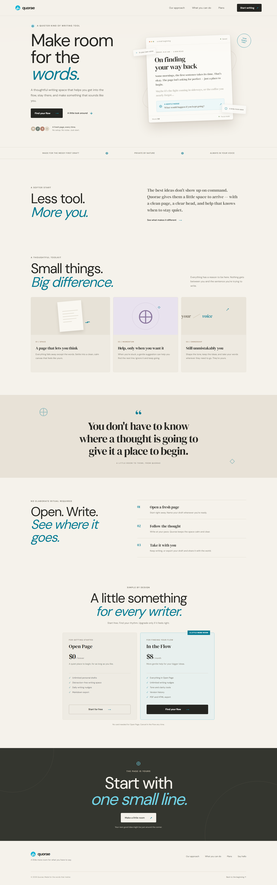

# Quorae — Make room for the words

A calm, editorial landing page for Quorae, a fictional writing companion. Built with plain HTML, CSS, and JavaScript—no framework or build step.



## Run locally

Open `index.html` in a modern browser, or serve this folder locally:

```powershell
python -m http.server 8000
```

Then visit [http://localhost:8000](http://localhost:8000).

## Page sections

- **Hero:** Product introduction and a CSS-built writing workspace preview.
- **Approach:** A short explanation of Quorae's calm, writer-first philosophy.
- **Features:** Focused writing space, optional writing nudges, and voice tools.
- **How it works:** Three small steps from opening a draft to exporting it.
- **Plans:** Free and paid tiers.
- **Closing CTA and footer:** A final prompt and useful page links.

## Motion and accessibility

Motion is intentionally restrained: the editor preview drifts gently, content reveals as it enters the viewport, and interactive controls use subtle hover transitions. The mobile navigation is keyboard-operable and exposes its expanded state to assistive technology. Animations are disabled when `prefers-reduced-motion` is enabled.

## Files

| File | Purpose |
| --- | --- |
| `index.html` | Semantic page structure and content |
| `styles.css` | Visual design, responsive layout, and reduced-motion styles |
| `script.js` | Mobile navigation, reveal-on-scroll, and current year |
| `screenshot.png` | Full-page desktop preview |

The page uses DM Sans and DM Serif Display from Google Fonts, with system font fallbacks. Replace the sample contact links and fictional plan details before using Quorae commercially.
